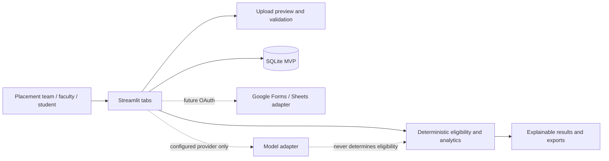

# Placement Intelligence & Employability Management System

A local-first MVP for one PGDM college placement department. The current working core is deliberately deterministic: explicit job rules drive eligibility, skill overlap is a separate discovery signal, and analytics describe observed cohorts without claiming causality. No LLM makes candidate eligibility or hiring decisions.

**Live app:** https://placement-intelligence-system-gnkdk6nkzbc4jnixcgjrpw.streamlit.app/

## Run on Windows

```powershell
cd placement_intelligence
py -m venv .venv
.\.venv\Scripts\Activate.ps1
python -m pip install -r requirements.txt
Copy-Item .env.example .env
streamlit run app\main.py
```

Open the local URL shown by Streamlit. The local `data/` folder can contain sample records for trying the app; those files are intentionally excluded from GitHub. To run the core checks: `python -m pytest tests`.

## Capabilities in this MVP

- Student master records and CSV/XLSX preview; upsert import with student ID mapping and duplicate visibility.
- PDF text extraction with optional local OCR fallback for scanned student profiles/resumes and JDs.
- JD Reader Agent proposes fields from text PDFs and common XLSX/CSV JD layouts; placement staff review and confirm every field before saving.
- Versioned mandatory eligibility thresholds with eligible, ineligible, and needs-verification explanations.
- Preferred skill overlap shown separately from eligibility.
- Job/application tracking, duplicate nomination protection, stage event history, and funnel counts.
- Descriptive cohort reports, small-sample suppression, CSV/JSON exports, audit events.
- Dataset templates under `templates/`.

The JD upload and extraction flow is available under **Jobs & Eligibility → Upload JD & extract**. It supports PDFs and typical labeled/tabular XLSX/CSV input. Student profile/resume PDFs use the same text extraction and OCR fallback under **Students & uploads**; OCR displays extracted text for review and does not automatically create or change a student record. The project environment includes the Python OCR wrappers and Poppler; scanned PDFs also require the Tesseract OCR engine. The app detects Tesseract on `PATH`, in `.tools/tesseract`, or in the standard Windows install folder. OCR is local; no PDF is sent to an external service. Extraction is a pattern/table reader rather than an external LLM agent; verify the JD and mandatory criteria before saving. OCR is limited to 20 pages per upload by default. Uploads for feedback, applications, and stage results currently provide preview only. The Google/model adapters are interfaces only and require implementation and credentials. The role selector is demonstration scaffolding, not production authentication/RBAC. SQLite is the working store; `core/storage.py` keeps schema SQL isolated for a PostgreSQL migration.

## Architecture



## Data model

SQLite tables cover students, jobs with rule versions, unique student/job applications, stage events, faculty feedback, and audit log. Student academic history beyond the current graduation/PGDM percentage fields is stored as profile JSON if provided. Add normalized academic term/internship/resume tables before production scale.

## Security and governance

The local MVP has no real authentication, encryption-at-rest policy, secret management, or deployed network controls. Do not upload identifiable student records to a shared or public deployment until these controls, consent, retention, and access policies are established. Limit fields to placement purpose, omit protected attributes, log human corrections, and send missing/conflicting evidence for human review. Selection analytics indicate associations only; they do not prove root causes.

## Roadmap

1. Add authenticated RBAC and production database migrations/backups.
2. Normalize academic terms, internships, structured rubric feedback, resume versions, and application events.
3. Complete per-dataset import mapping, validation reports, OCR opt-in, and correction workflows.
4. Implement Google OAuth with least-privilege Forms/Sheets scopes and reviewed column mappings.
5. Add optional LangGraph orchestration for bounded extraction/summarization agents, with human review and deterministic rules retained as the authority.
6. Add cohort-level monitoring, privacy review, retention controls, and deployment hardening.

## Environment

See `.env.example`. Database defaults to local SQLite. Google OAuth and any external model provider are optional future setup and are not active by default.

## Streamlit Community Cloud demo deployment

This repository is configured with `packages.txt` for Linux Tesseract and Poppler so scanned-PDF OCR can run in Streamlit Community Cloud. `requirements.txt` installs the Python dependencies. In Streamlit Community Cloud, deploy `app/main.py` from the repository root.

The app currently uses a local SQLite file; hosted app files and SQLite changes can be lost when the app restarts or redeploys. The role picker is not authentication or access control. Do not upload identifiable student records or resumes to a public/community deployment. Before any real college use, add authenticated RBAC, a managed database with backups, and an approved privacy/security review. Keep secrets in Streamlit's Secrets settings, never in Git.

### Publish checklist

1. Create a GitHub repository. A private repository is the safer default while the app is in development.
2. Push this project without `.env`, `.streamlit/secrets.toml`, `.venv`, or `placement.db`; `.gitignore` excludes them.
3. In Streamlit Community Cloud, create an app from that repository and select `app/main.py` as the entry point.
4. No student sample records are bundled in the public repository. Import only data you have permission to use; local SQLite is temporary on hosted instances.
5. After deployment, test the dashboard, uploads, JD extraction, and OCR with synthetic documents.
